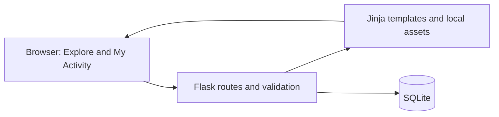
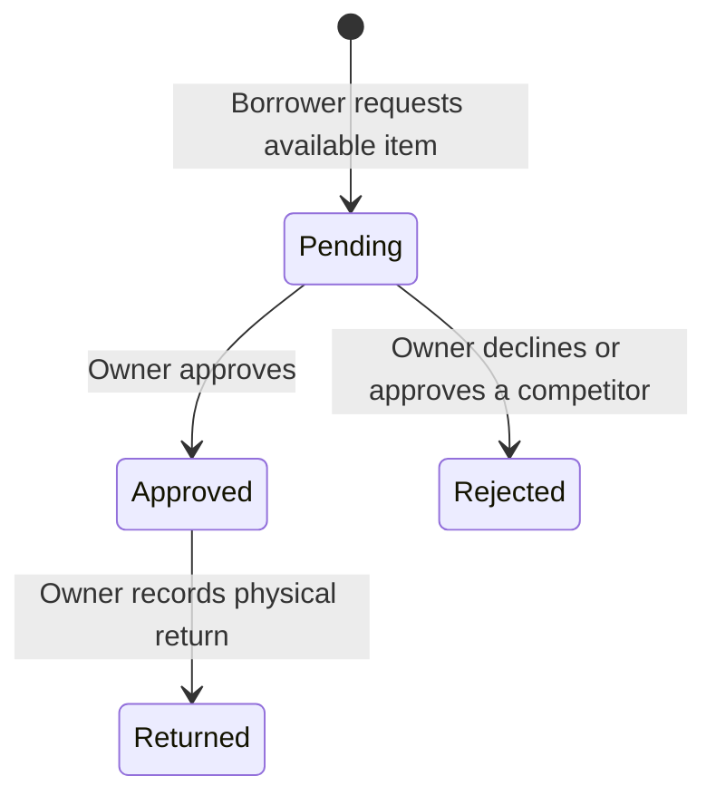

# Campus Commons — design

## Architecture

One Flask process serves Jinja HTML, local CSS/JavaScript, and SQLite-backed forms. No frontend build, remote APIs, or external assets are required. Python's `sqlite3` module handles persistence. JavaScript only improves identity switching and guards against repeated clicks; the core workflow uses ordinary HTML forms.

`create_app(config)` initializes storage and seed data. Each request gets its own SQLite connection with foreign keys enabled and a five-second busy timeout. Write transactions commit together or roll back together. Connections close at request end.

`instance/commons.sqlite3` stores app data. `instance/secret.key` holds a generated session-signing key, reused across restarts. `COMMONS_DATA_DIR` can select a different runtime data directory. Tests pass a temporary directory and a fixed community date through app configuration.

## Data model

| Table | Fields / purpose |
|---|---|
| `members` | ID, display name, unique fictional email. Three seeded members. |
| `items` | ID, owner ID, name, category, description, condition, creation timestamp. One row represents one physical item. |
| `borrow_requests` | ID, item ID, borrower ID, expected return date, status, creation timestamp. |
| `metadata` | Seed-version marker to prevent reseeding after restart. |

IDs are integers; item and request IDs auto-increment. Foreign keys link ownership and borrowing. Categories are Sports, Electronics, Books, Tools, Outdoors, and Other. Conditions are Like new, Good, and Fair. Item names contain 1–100 trimmed characters and descriptions 1–600.

A unique partial index permits at most one `Approved` request per item. Another permits at most one `Pending` request for a given borrower/item pair, preventing duplicate submissions while allowing later requests after rejection or return. Availability is derived: an item is Borrowed if it has an Approved request, otherwise Available. There is no separate availability field that can drift out of sync.

## Screens and forms

- **Explore:** available items, owner labels, pending-request links, and List an item. Owned items show a non-borrowable “Your item” label. Borrowed items are hidden from Explore and remain visible through activity history.
- **List an item:** required name, category, condition, and description. The backend assigns the selected member as owner; submitted ownership fields are ignored.
- **Request to borrow:** item summary and expected return date. A date is required and must be today or later in Asia/Kolkata. Submission creates a Pending request; it does not reserve the item.
- **My Activity:** incoming and outgoing request history, newest first. Pending incoming requests have approve/reject actions; Approved incoming requests have a return action. On mobile, outgoing requests appear first when there are no incoming requests.
- **Approved outgoing request:** persistent Request approved / Accepted card with saved owner name, fictional email, item, expected return date, and instructions to arrange the handover outside the app. After return, a Returned history entry replaces the handover card.
- **Demo member selector:** a signed session cookie stores member ID. Default is Amritanshu. The selector preserves Explore or My Activity where applicable; switching from an entry form returns to Explore.

The layout adapts to desktop and mobile. All forms work without JavaScript. Pages use semantic labels, focus indicators, local vector icons, and no uploaded imagery. Approval changes appear when the borrower switches identity, navigates, or refreshes; there is no live push.

## Routes and interfaces

| Method | Route | Input / result |
|---|---|---|
| GET | `/` | Render available catalogue. |
| POST | `/demo-member` | `member_id`, optional `next=activity`; switch demo member. |
| GET | `/items/new` | Render listing form. |
| POST | `/items` | `name`, `category`, `description`, `condition`; create listing. |
| GET, POST | `/items/<id>/request` | POST accepts `expected_return` as ISO `YYYY-MM-DD`; create request. |
| GET | `/activity` | Incoming and outgoing requests for selected member. |
| POST | `/requests/<id>/approve` | Approve Pending request and reject competitors. |
| POST | `/requests/<id>/reject` | Reject Pending request. |
| POST | `/requests/<id>/return` | Mark Approved request Returned. |
| GET | `/health` | JSON `{"status":"ok"}` after a database readiness query. |

Every POST includes a session CSRF token. Successful mutations redirect with HTTP 303 to prevent replay on refresh. Invalid fields return 422 with preserved input; invalid identity returns 400; unauthorized actions/CSRF failures return 403; missing records return 404; stale or duplicate requests return 409. Oversized forms return 413. Database lock contention returns 503 with retry guidance.

## Lifecycle and approval integrity

For approval, acquire a SQLite `BEGIN IMMEDIATE` write transaction, load the request and owner, verify ownership and Pending status, and recheck that no Approved borrow exists. Set the chosen request Approved and all other Pending requests for that item Rejected, then commit. SQLite serializes writes, and the unique partial index provides a second integrity guard. A stale competing approval fails rather than creating a second active borrow.

Borrow submissions also recheck availability in their write transaction. Returning requires the owner and an Approved request; changing it to Returned makes availability true without a separate update. Rejecting a request leaves availability unchanged. An overdue date does not automatically release an item: only its owner can record return. The expected return date is validated at submission; requests are not automatically expired.

Owner checks are workflow guards against the selected demo member, not real authentication. The app uses escaped Jinja output, parameterized SQL, HttpOnly/SameSite session cookies, CSRF tokens, bounded form size, and a same-origin content policy. These do not make the demo suitable for public production deployment.
