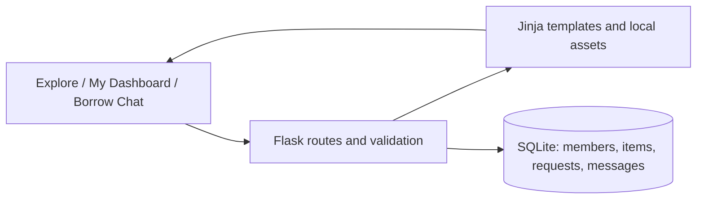
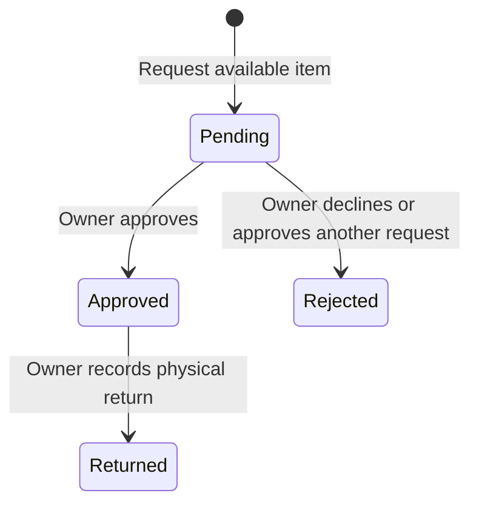

# Campus Commons — V0.3 design

## Architecture and agreed baseline

One local Flask process serves Jinja pages, static CSS/JavaScript, and SQLite-backed forms. The V0.3 source brief adds personal inventory and borrow-specific chat. The agreed implementation retains Flask/Jinja + SQLite and local-only delivery, overriding the brief's React SPA, Supabase, and public-deployment suggestions. No frontend build or external API is required.

`create_app(config)` initializes storage. `instance/commons.sqlite3` holds data; `instance/secret.key` holds the persisted session-signing key. `COMMONS_DATA_DIR` can select another runtime directory. Each request uses its own SQLite connection with foreign keys enabled and a five-second busy timeout. Connections close at request end. `BEGIN IMMEDIATE` serializes write transactions, which commit or roll back together.

## Data model and upgrade

| Table | Fields / purpose |
|---|---|
| `members` | ID, display name, unique fictional email. Amritanshu, Rahul, and Priya are seeded. |
| `items` | ID, owner ID, name, category, description, condition, creation timestamp. One physical item per row. |
| `borrow_requests` | ID, item ID, borrower ID, expected return date, status, creation timestamp. Also acts as the conversation identifier. |
| `messages` | Auto-increment ID, borrow-request ID, sender ID, plain-text body, UTC creation timestamp. Foreign keys reference the borrow and member. |
| `metadata` | Seed-version marker, preventing reseeding on restart. |

Names contain 1–100 trimmed characters, descriptions 1–600, and messages 1–1,000. Categories are Sports, Electronics, Books, Tools, Outdoors, Other; conditions are Like new, Good, Fair. Messages are indexed and ordered by `(borrow_request_id, created_at, id)` for deterministic ordering when timestamps tie. Sender is always the selected member, never a submitted field.

A unique partial index permits only one Approved borrow per item. Another permits only one Pending request per borrower/item pair. Availability is derived from active Approved requests, with no duplicate listing status. Display that state as **Lent Out** in the owner's inventory.

Schema initialization runs before the seed-marker check. Existing databases receive `messages` and its index through additive `CREATE ... IF NOT EXISTS` statements. No old rows, constraints, signing key, or seed marker are changed. Existing Approved/Returned requests immediately have an empty conversation. No conversation backfill, reset, or separate migration service is needed.

## Screens

- **Explore:** available items with owner, category, condition, and description. Own listings cannot be requested; Pending requests link to the dashboard. Borrowed items disappear until return.
- **List an item:** required fields with backend ownership assignment and validation. The form remains a simple server-rendered page.
- **Request to borrow:** expected return date, today or later in Asia/Kolkata. Pending requests do not reserve an item; borrowing starts on approval.
- **My Dashboard / My Items:** every owned listing, newest first, including listings with no requests. Available/Lent Out badge; borrower and return date for active lending; pending actions grouped under each item; collapsible lending history with Returned conversation links.
- **My Dashboard / Borrowing:** Approved borrows first, then Pending requests, then Returned/Rejected history. Show owner and expected return date. Approval retains Request approved / Accepted, with Open chat as the main action and fictional owner contact in secondary expandable details.
- **Borrow Chat:** owner, borrower, item, state, expected return date, and messages with sender/time. Approved participants have a composer. Returned conversations show a read-only notice and no composer. The owner can also record return from this screen.

The visible selector stores the demo member ID in a signed session cookie. Default is Amritanshu. Switches on the dashboard stay there; switches from chat go to the dashboard, requiring another participant check before opening a conversation. Switches from item forms return to Explore. Identity is shared across tabs in one browser session.

All forms work without JavaScript. JavaScript provides immediate member switching and repeated-click prevention only. New replies load through **Refresh messages** or navigation; there is no polling, WebSocket, typing indicator, or read receipt. Text is escaped, with line breaks preserved in CSS. The UI asks users to avoid addresses/phone numbers; it does not inspect or redact messages.

## HTTP interfaces

| Method | Route | Behavior |
|---|---|---|
| GET | `/` | Available catalogue. |
| POST | `/demo-member` | Validated `member_id` and whitelisted `next`; switch identity. |
| GET | `/items/new` | Listing form. |
| POST | `/items` | `name`, `category`, `description`, `condition`; create selected member's listing. |
| GET, POST | `/items/<id>/request` | Request form; POST accepts ISO `expected_return`. |
| GET | `/dashboard` | Owned inventory, pending requests, active borrowing, history. |
| GET | `/activity` | Compatibility redirect to `/dashboard`, HTTP 303. |
| POST | `/requests/<id>/approve` | Owner-only atomic approval and rejection of competing Pending requests. |
| POST | `/requests/<id>/reject` | Owner-only rejection of Pending request. |
| POST | `/requests/<id>/return` | Owner-only Approved → Returned. |
| GET | `/borrows/<id>` | Participant-only Approved/Returned details and messages. |
| POST | `/borrows/<id>/messages` | Participant-only `body`, while Approved. |
| GET | `/health` | `{"status":"ok"}` after a database query. |

Every POST checks a CSRF token. Successful mutations use HTTP 303. Invalid fields return 422 with input preserved. Invalid member returns 400; non-participant/owner or CSRF failure returns 403; missing record returns 404; stale transitions, unavailable conversations, duplicate requests, or sending after return return 409. Oversized forms return 413; database lock contention returns 503 with retry guidance.

## State and access integrity

Approval loads the request in a write transaction, checks owner and Pending status, rechecks availability, approves it, and rejects competing Pending requests before commit. The unique index provides a second guard. Returning changes the request to Returned and immediately releases derived availability. Requests are not auto-expired; overdue items stay lent until the owner records return.

Every chat GET/POST loads the borrow, checks the selected member is its owner or borrower, and requires Approved/Returned status. POST additionally requires Approved, performing the check and insert in one write transaction. If sending commits before return, its message stays in history; if return commits first, sending is rejected. Pending/Rejected requests cannot open chat. Another borrow of the same item uses a different request ID and a separate conversation.

Demo identity selection is not authentication: a person can choose another demo member. Participant checks enforce the workflow for the selected member, not production-grade privacy. Jinja escaping, parameterized SQL, CSRF, HttpOnly/SameSite cookies, no-store responses, and a same-origin content policy remain. The server stays bound to loopback.
