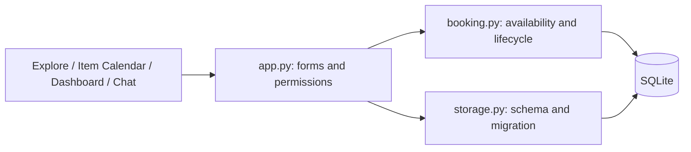
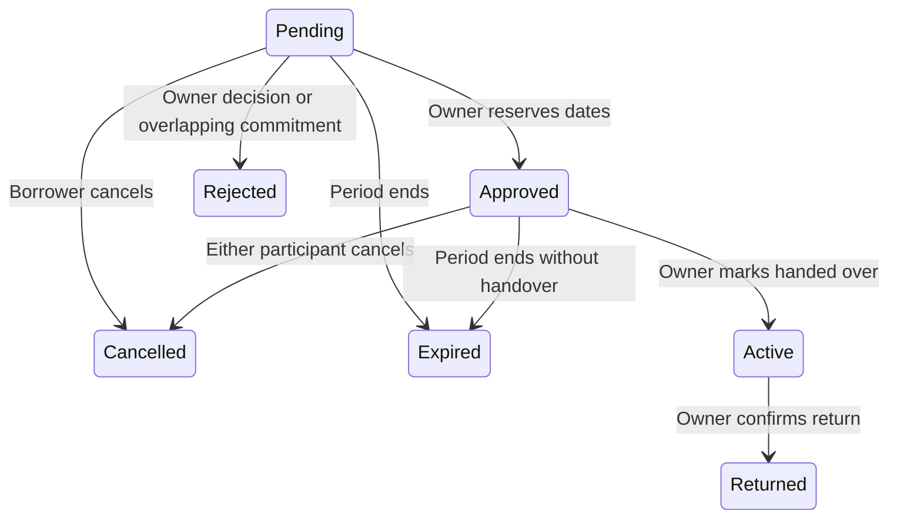

# Campus Commons — discovery and calendar design

## Implemented baseline

A local Flask/Jinja application, SQLite, one North Campus community, and seeded Amritanshu/Rahul/Priya. This combines the focused V1.0 review improvements with the subsequently agreed calendar requirements. Source briefs stay unchanged; the review's Express ZIP findings do not describe this Flask codebase. React/Supabase, public hosting, and real authentication remain deferred.

HTML forms work without JavaScript. Local JavaScript adds immediate member switching, repeat-submit prevention, and calendar range selection. Date fields remain available. Calendar month links preserve selection when JavaScript is enabled. No third-party assets, calendar service, frontend build, background worker, or live chat connection is required.

## Discovery and listing state

Explore searches names using a parameterized literal substring and combines an optional allowed-category filter. SQL `lower` provides case-insensitive matching for the English demo catalogue. Filter values stay in GET parameters. Paused/Archived items are excluded; currently reserved/lent items remain discoverable for future requests. Result counts refer to the matching catalogue.

Each item has `sharing_state = Listed | Paused | Archived`. Current availability is derived, not another mutable database field: state first, then overdue custody, Active custody, a reservation today, an owner block today, or Available now. Upcoming reservations do not imply current physical custody.

Public detail pages show description, category, condition, owner, and a free/busy calendar. They reveal no borrower names or request/chat details. Owner controls manage editing, pause/resume, archive/restore, pending requests, and unavailable dates. Editing/pause/archive require no Approved/Active commitments; an Archived item must be restored before editing. Pause/archive atomically rejects Pending requests with a reason. No item hard-delete route exists.

## Data model

| Table | Important fields |
|---|---|
| `members` | Stable ID, name, fictional email. |
| `items` | Owner, name (1–100), category, description (1–600), condition, sharing state, created/updated timestamps. |
| `borrow_requests` | Item, borrower, start date, inclusive `expected_return`, status, created/approved/decided/handed-over/returned/cancelled/expired timestamps, resolution reason. |
| `unavailable_dates` | Item, inclusive start/end dates, creation timestamp. |
| `messages` | Borrow-request ID, sender ID, trimmed plain text (1–1,000), UTC creation timestamp. |
| `metadata` | Seed version and calendar schema version. |

Foreign keys connect ownership, borrowers, and messages. Messages use the request itself as their conversation key. Message ordering is creation time then ID. The selected session member supplies the sender; submitted owner/sender IDs are ignored.

Date fields are canonical ISO `YYYY-MM-DD` dates in Asia/Kolkata. New requests/blocks require start >= today and end >= start. Ranges include both boundary days. A 1–10 reservation conflicts with 10–12 but not 11–12. Month navigation and request windows can cross months/years.

## Reservation and custody lifecycle

- Pending requests do not block dates. Multiple members can request overlapping periods. One member cannot create overlapping Pending requests for the same item, but can request distinct periods.
- Submission/approval checks Listed state, owner blocks, existing Approved/Active ranges, and overdue custody. Approval rejects only overlapping Pending requests; disjoint requests remain open.
- Approved reserves dates and opens chat. Only the owner can start borrowing during the reserved period. Another Active borrow blocks handover, even if its expected date has passed.
- Active represents the owner's handover assertion. Only the owner records return. An early return releases the remainder immediately while preserving other reservations/blocks.
- Either participant cancels Approved before handover. Only the borrower cancels Pending; owners reject Pending. Active borrows cannot be cancelled.
- On app operations, elapsed Pending/Approved periods become Expired. No background job is required. An unstarted reservation can still be approved/handed over after its start date if its period has not ended.
- Active records never auto-expire or return. Overdue means Active and expected return < community today. Today itself is not overdue. An overdue item pauses new requests/approvals, keeps existing future approvals with warnings, and blocks subsequent handover until return.
- Rejected/Cancelled/Expired records do not reopen when dates become free. New requests are required. Booking-date changes/extensions are not implemented.

Owner unavailable-date blocks cannot overlap Approved/Active windows or other blocks. Creating a block rejects only overlapping Pending requests; removing one never changes other reservations. Owners may manage non-conflicting future blocks while an item is lent, but cannot modify Archived calendars until restore.

## Consistency and access

Writes use `BEGIN IMMEDIATE` with a five-second SQLite busy timeout. Approval, competing rejections, handover, return, cancellation, listing-state changes, and owner blocks are each transactional. Availability is rechecked under the write lock.

Database triggers reject overlapping Approved/Active ranges and owner-block conflicts. A unique partial index enforces one Active physical borrow per item. An exact Pending-window index and the transactional self-overlap check prevent repeated/overlapping submissions. Date-range indexes support availability queries. Concurrent conflicting approvals yield one success and one stale/conflict error, with no partial update.

Only participants can read borrow details/chat. Approved/Active allow sending. Returned and previously approved Cancelled/Expired records allow reading only; `approved_at` distinguishes closed, previously approved conversations from unapproved ones. Sending checks participant and status in the write transaction, so a return/cancellation racing with a send cannot permit a later message. Legacy Returned/Active conversations remain readable even where historical timestamps are unknown.

Every POST has CSRF protection. Jinja escapes user content; message line breaks are preserved with CSS. Forms have input limits, session cookies are HttpOnly/SameSite, responses are no-store, and static assets obey the same-origin content policy. Member selection is a demo workflow guard, not authentication. The server cannot verify real custody or sanitize personal facts from messages.

## Routes and responses

| Methods | Route | Purpose |
|---|---|---|
| GET | `/?q=...&category=...` | Search/filter discoverable listings. |
| GET | `/items/<id>?month=YYYY-MM` | Details, free/busy month, reservation form, owner controls. |
| GET / POST | `/items/new` / `/items` | Create listing. |
| GET, POST | `/items/<id>/edit` | Owner edit form/save. |
| GET, POST | `/items/<id>/sharing-status` | Confirm/save `action=pause|resume|archive|restore`. |
| GET, POST | `/items/<id>/unavailable-dates` | Owner management link / create date block with `start_date,end_date`. |
| POST | `/items/<id>/unavailable-dates/<block_id>/remove` | Remove own block. |
| GET, POST | `/items/<id>/request` | GET redirects to detail; POST accepts `start_date,expected_return`. |
| POST | `/requests/<id>/<action>` | `approve`, `reject`, `start`, `return`, `cancel`, with actor/state checks. |
| GET | `/dashboard` | Inventory, reservations, custody, alerts, and history. |
| GET | `/activity` | Compatibility redirect to dashboard. |
| GET / POST | `/borrows/<id>` / `/borrows/<id>/messages` | Participant chat / send `body`. |
| POST | `/demo-member` | Select allowed demo ID; whitelist redirect destination. |
| GET | `/health` | Database readiness JSON. |

Successful mutations redirect with 303. Invalid form values return 422 with values preserved. Invalid query/category/member input returns 400, denied actions 403, missing records 404, and stale/conflicting actions 409. Oversized forms return 413 and database contention 503. Closed chat explains read-only status. There is no HTTP reset endpoint.

## Automatic migration and persistence

`storage.py` detects the legacy request table by its missing start date. Before modifying it, SQLite's backup API creates `instance/backups/commons-before-calendar-<UTC timestamp>.sqlite3`. The signing key stays unchanged.

The upgrade uses a transaction, temporarily disabling foreign-key enforcement outside the transaction as required for a parent-table rebuild. It adds item sharing state/update time, copies requests into the new constrained table preserving IDs, drops the old parent, renames the new parent, preserves the auto-increment sequence, and recreates indexes/triggers. Message foreign keys keep the original parent name. A foreign-key check must pass before committing the schema version. Failure rolls back; the original database and backup remain.

Old Approved records become Active because the earlier app treated approval as borrowing. Legacy start dates are request-creation dates converted to Asia/Kolkata. Actual historical handover/return/decision times are not invented. Old IDs, messages, conditions, contacts, seed marker, and key remain. Missing message tables from older physical-sharing versions are created. Fresh databases initialize the latest schema and six seed items directly; restarts never reseed or repeat a successful migration backup.

Reset remains a deliberate local file operation documented in README. It is never performed by upgrade, tests, or an unauthenticated endpoint. Test and browser QA databases are separate from visible demo data.
